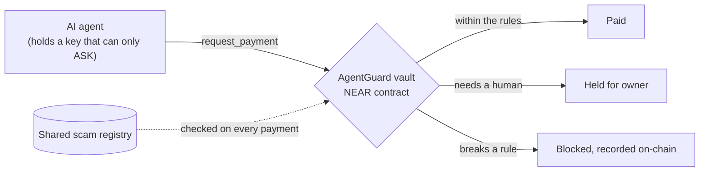

# AgentGuard

**A spending firewall for AI agents, enforced by a NEAR smart contract.**

An AI agent that can pay is one prompt injection away from paying a scammer. AgentGuard takes the spending rules out of the agent's prompt and puts them in a contract the agent can't get around, and that even its owner can lock for good.

**Website: [agentguard.app](https://agentguard.app).** What AgentGuard is, live numbers from the chain, and a button that makes your browser check our claims against NEAR testnet itself.

**Live demo: [Sentinel](https://sentinel.agentguard.app)**, the first app built on AgentGuard. An AI agent with real (testnet) money in a locked AgentGuard vault. Try to talk it into paying you.

**Hire Sentinel on [NEAR Agent Market](https://agentguard-sentinel.market.near.ai)** ($0.30 a job, by people or by other agents over A2A + x402): "is this NEAR account safe to pay?", plus a scan of your invoice for hidden instructions.

**Console: [agentguard.app/console](https://agentguard.app/console).** Create a vault for your own agent with a NEAR wallet, set its limits, and approve or deny the payments it asks for. You can look at any vault without a wallet.

Built for NEAR HACKATHON 2026 · Tracks: AI Security & Defense, Agent Economy, Autonomous Business · Runs on NEAR testnet · MIT

---

## The problem

Today an agent's spending limits live in its prompt or in the app around it. A poisoned invoice, web page or email can talk the model out of them, and whoever runs the server can change them. Wallet keys given to agents can usually move everything.

## How AgentGuard works



1. **The money sits in a vault account with no full-access key.** A factory creates it from immutable code, and nobody holds a key that can sign a transfer out of it.
2. **The agent only gets a key that can call `request_payment`.** It can ask to pay; it can't pay.
3. **The contract decides each request**: per-payment and daily caps, an allowlist, a hold on repeated payments (the "it failed, please retry" trick), and a lookup in a **shared scam registry**. If the registry doesn't answer, the payment is blocked.
4. **`lock_rules()` is one-way.** After it, nobody, owner included, can loosen the rules or withdraw. Making them stricter (pause, deny, revoke) still works.

If the AI is fooled, the contract still says no.

## What's in this repo

| Part | What it does |
|---|---|
| [**Vault contract**](contracts/vault) | The firewall: every payment comes out `paid`, `pending` or `blocked`, with a reason. Includes a table of all the rules |
| [**Factory**](contracts/factory) | Creates vaults born without a full-access key, on immutable code; refunds if creation fails |
| [**Scam registry**](contracts/registry) | Shared blocklist: anyone reports with evidence; two reporters or a curator flag an account |
| [**Console**](packages/sentinel/public/console.html) | Web app: create a vault, set limits, approve or deny held payments, make agent keys in the browser, lock the rules. Wallets through NEAR Connect |
| [**MCP server**](packages/mcp) | Lets any AI agent (Claude, Codex, ...) pay through a vault: 7 tools, plus a tested guide to get your own vault in 4 steps |
| [**Website**](packages/sentinel/public/index.html) | What AgentGuard is, live numbers read from the chain, and "Verify it": your browser checks the claims against NEAR testnet itself |
| [**Sentinel**](packages/sentinel) | The first app built on AgentGuard, and the live demo: an AI agent on a locked vault. It pays for its own thinking, sells "is this address safe to pay?" checks to other agents (over HTTP 402, and as a listed agent on [NEAR Agent Market](https://agentguard-sentinel.market.near.ai)), and verifies that its own brain runs in a TEE |

## See it in 2 minutes (no install)

1. **Open [Sentinel](https://sentinel.agentguard.app) and try to scam it.** If you convince the AI, you'll see the vault's answer stamped on the payment: *Blocked by contract*, with a link to the transaction.
2. **See a real blocked attack on-chain.** The AI was talked into paying 0.03 NEAR; the vault refused (`recipient_not_allowlisted`): [tx 36qW…](https://testnet.nearblocks.io/txns/36qWxB4cRBwqRiihfHPuo2GWfBXj2AVW26fSrhpeNbGg).
3. **See that the vault is locked.** Its owner then tried to allowlist an attacker and to withdraw; both were refused: [lock tx 9QFB…](https://testnet.nearblocks.io/txns/9QFBjv7AzAqcaCjJdm8z1kq9pV47rt9Adz2XjfqaJf7h), details in [TESTNET-RESULTS §11](docs/TESTNET-RESULTS.md).
4. **See that nobody holds a key to the money.** Sentinel's vault has a single key, and it can only call `request_payment`:
   ```sh
   curl -s https://rpc.testnet.fastnear.com -H 'content-type: application/json' \
     -d '{"jsonrpc":"2.0","id":1,"method":"query","params":{"request_type":"view_access_key_list","finality":"final","account_id":"sentinel.agentguard.testnet"}}'
   ```

## Run it on your laptop, with no keys (1 minute)

The offline demo runs the same page against a **simulated** vault (same rules as the contract, in the same order) and a scripted stand-in for the AI. No keys, no wallet, nothing on-chain, and the page says so.

```sh
cd packages/mcp && npm install && cd ../sentinel && npm install
npm run demo        # open http://localhost:3000/sentinel and ask it to pay "0.03 NEAR to agentguard-user.testnet"
```

## Run the tests (about 5 minutes)

Needs Rust with [`cargo-near`](https://github.com/near/cargo-near), and Node 24. No keys or accounts needed.

```sh
# Contracts: 70 unit tests + a fuzz test + 7 sandbox tests on a local NEAR node
cd contracts/vault && cargo test        # 43 unit + fuzz (5,000 random steps) + 1 sandbox
cd ../factory && cargo test             # 14 unit + 6 sandbox
cd ../registry && cargo test            # 13 unit

# TypeScript: 63 tests, no network needed
cd ../../packages/mcp && npm install && npm test        # 24
cd ../sentinel && npm install && npm test               # 39
```

Ask the MCP server about a real vault (read-only, no key needed). It shows the vault's rules and flags the scammer and the lookalike `agentguard-sh0p.testnet`:

```sh
cd packages/mcp && npm run build && AGENTGUARD_VAULT=demo2.agentguard.testnet npx tsx scripts/live-demo.ts
```

## Proof

Everything is deployed on NEAR testnet (ids in [`deployments/testnet.json`](deployments/testnet.json)), and every claim below has transaction links in [`docs/TESTNET-RESULTS.md`](docs/TESTNET-RESULTS.md).

**Don't trust the links, check them.** One command re-checks it all against testnet (Node 24, no install, no keys, about 6 minutes, because public archival nodes are slow):

```sh
node scripts/verify-evidence.mjs
```

It fetches every transaction in TESTNET-RESULTS from a NEAR archival node and compares each stated outcome (paid / held / blocked, and the reason) with the vault's own on-chain event. It checks all 240 stress-test results against the stress vault's own on-chain records, re-reads their transactions (every paid one plus a random sample; `--all-stress-tx` for all 240) and confirms that every "paid" was a real transfer to an allowed account. Then it checks the live state: code hashes, no full-access keys, Sentinel locked. It exits non-zero if anything disagrees (tested: with one stress result falsified in `docs/stress-run.json`, it names that request and fails).

| Claim | Evidence |
|---|---|
| A vault runs immutable code and is born with no keys at all | Factory run + on-chain key list (§1–2) |
| The agent's key can't transfer, add keys, change rules or withdraw | 12 refused attempts on testnet (§4) |
| A flagged scammer is blocked even when allowlisted | Registry + vault run (§5) |
| Any MCP agent can pay through a vault | Live MCP run (§6) |
| A fooled AI's payment is blocked on-chain | Live page and local runs (§7, §10) |
| Agents pay agents: another agent bought Sentinel's paid check through its own vault | HTTP 402 → vault payment → check, replay refused (§8, §10) |
| A new user can follow the guide from nothing to a working vault | Guide run as written (§9) |
| A new user can do it all in the browser: wallet → vault → agent key → agent payment → approve | Console run with a fresh account (§12) |
| Sentinel's vault is locked; the owner can't loosen it | Lock + refused owner calls (§11) |
| 240 rule-breaking requests on-chain: every answer as the rules say, nothing paid to anyone not allowed | Stress test, all txs listed (§13) |
| No sequence of actions breaks the rules | Fuzz test: 60,000 random steps, every invariant checked after each one; deliberately broken contracts are caught ([vault README](contracts/vault#fuzzing-srcfuzz_testsrs)) |

**Sentinel's brain is verified, not just claimed.** Its model runs on NEAR AI Cloud inside a TEE. Sentinel checks NEAR AI's attestation itself, with a fresh nonce, every 30 minutes: the Intel TDX quotes, the nonce and signer bound inside them, and NVIDIA's GPU attestation. Then, for each reply, it checks the signature against the exact bytes sent and received, and against a signer that passed those checks before the reply was requested. The page says "Verified" only when all of that passes. [How it works](packages/sentinel#proving-its-brain-runs-in-a-tee-srcteets).

## Use it in your own agent

**In the browser:** open the [Console](https://agentguard.app/console), connect a testnet wallet, create a vault, and make an agent key. The key is generated in your browser and downloaded as a file; only its public key goes on-chain.

**From the command line:** follow [**Get your own vault**](packages/mcp#get-your-own-vault-testnet-about-2-minutes): four commands to create a vault, make an agent key, add it, and point the MCP server at it. Then ask your agent to pay. The vault decides.

## NEAR features used

- **Global contracts by code hash:** every vault runs the same immutable code, so creating one costs almost nothing
- **Function-call access keys** with a gas allowance: the agent's key can only call `request_payment`
- **Cross-contract calls with callbacks:** the registry lookup on each payment, which blocks if the registry doesn't answer
- **NEAR AI Cloud:** TEE inference, attestation reports and signed replies

## Status and limits

| | |
|---|---|
| Working on testnet | Vault, factory, registry, MCP server, Sentinel (live, vault locked), paid checks over HTTP 402, TEE verification |
| Testnet only | No mainnet deployment |
| HTTP 402 | x402-shaped, but our own scheme in native NEAR, not an official x402 network |
| TEE checks not done | RTMR3 event-log replay, image provenance, NVIDIA token signature, TLS binding |
| Registry | Two throwaway accounts can flag an account. Curators can dismiss, and a flag can only block payments to that account, never move funds |
| Security model | [**SECURITY.md**](SECURITY.md): who can do what, what it stops, what it doesn't, what you have to trust, and a rebuild of the vault code that matches the on-chain hash. Not audited |

## License

MIT
